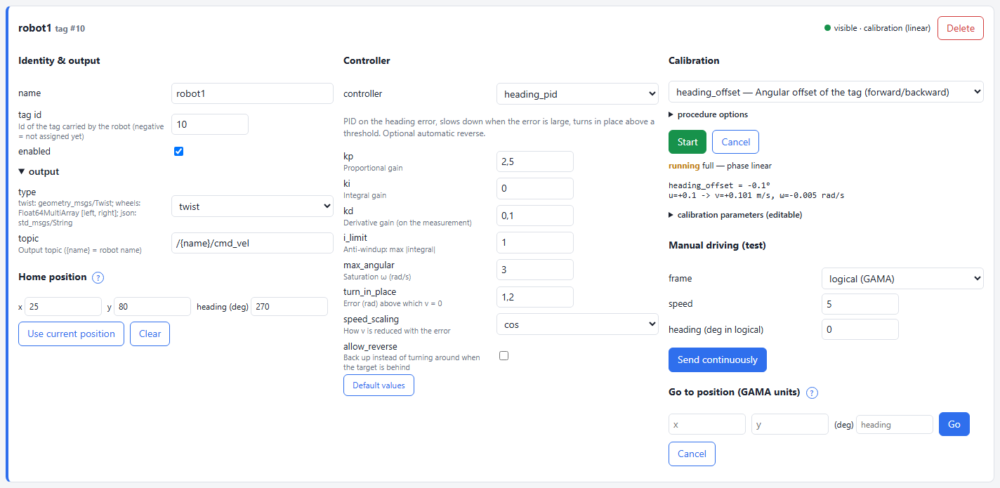
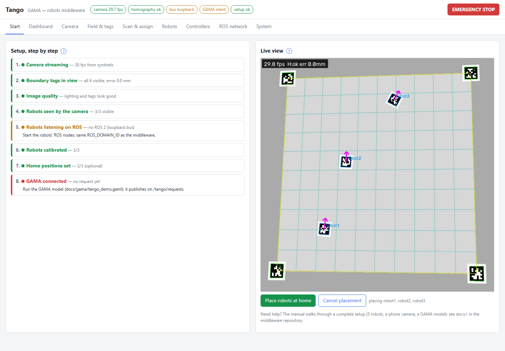
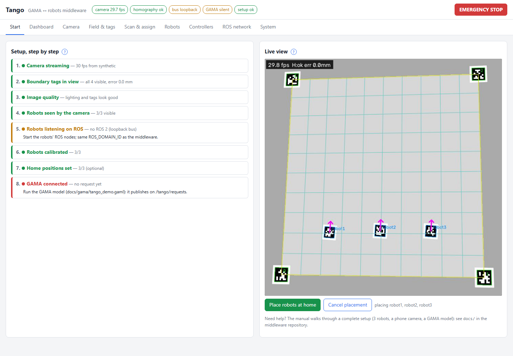

# 4. Calibration
{: .no_toc }

1. TOC
{:toc}

## Why

GAMA asks for speeds in GAMA units per second and headings in degrees; a robot receives a raw command
(`Twist` linear / angular). Between the two, every robot is a bit different: motors, wheels, battery,
a tag stuck slightly askew. The calibration **measures** each robot with the camera and corrects for it:

| Measured | Meaning |
|---|---|
| `heading_offset` | angle between the tag's FRONT arrow and the direction the robot really drives |
| `linear_gain`, `linear_deadband` | raw command per m/s, and the smallest command that makes it move |
| `drift_per_meter` | how much it curves when asked to drive straight (compensated afterwards) |
| `angular_gain`, `angular_deadband` | same for rotation (or the effective wheel base for a `wheels` output) |

## How

For each robot, one at a time, with **at least 50 cm of free floor around it** inside the field:

1. **Robots** tab → the robot's card → *Calibration* → procedure **full** → **Start**.
2. The robot drives forward and backward at a few speeds, then turns both ways (about 30 seconds). The log
   under the button shows each measurement.

   

3. When it ends (`done`), the results are applied and saved. The Start tab's *Robots calibrated* step
   counts calibrated robots.

The calibration stops by itself if the tag is lost, if the robot leaves the field, or on emergency stop.
If it reports *the robot did not move*, raise `forward_raw` / the levels in *procedure options*; if it
reports a reversed direction, tick `invert_linear` / `invert_angular` in the calibration parameters.

Test with **Manual driving**: frame *logical (GAMA)*, speed 5, heading 0 (east), **Send continuously**:
the robot must go straight towards the right of the field. Heading 270 = up, 90 = down, 180 = left.

## Start positions (home)

The demo starts by bringing every robot to its start position, so nobody has to place them precisely
by hand. In this scenario the GAMA model sends its own start positions (a row near the bottom, facing
up: GAMA (25, 80), (50, 80), (75, 80), heading 270). They are also stored as each robot's **home** in
the configuration, so you can use them without GAMA:

- **Start** tab → **Place robots at home**: the robots go to their home **one after the other** (no
  collision between moving robots), turn to their final heading, and stop.

To set a home from the real world: drive or put the robot where it should start, then **Use current
position** on its card.

Placement settings (speed, tolerance, distance kept to other robots, timeout) are under
**System → Placement**.

Next: [Running the demo](demo.md).
