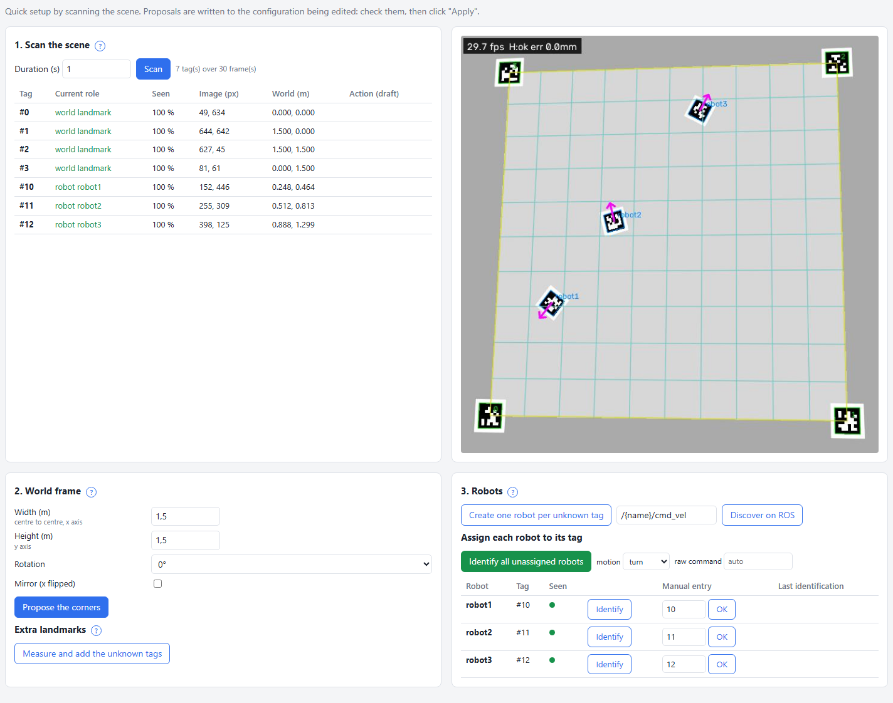
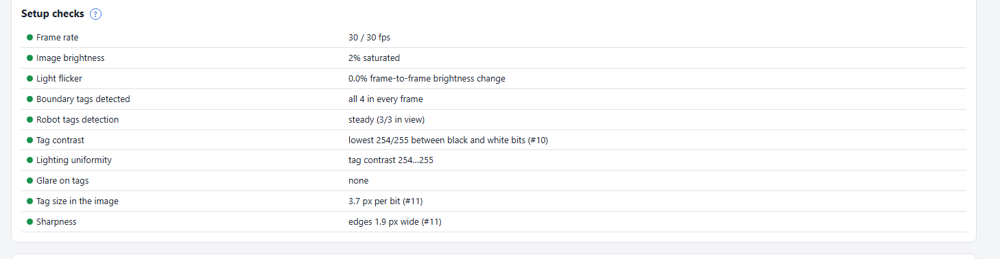
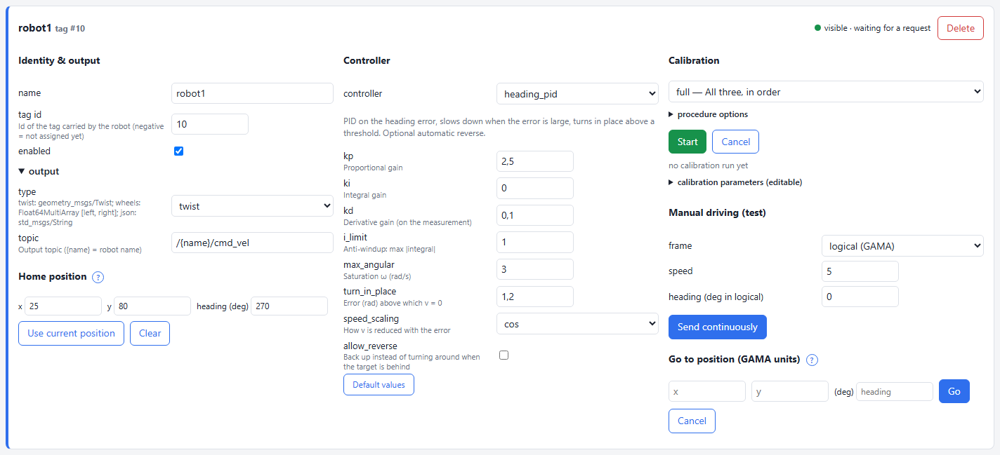

# 3. Configuration
{: .no_toc }

1. TOC
{:toc}

With the [example configuration](examples/config-3-robots.yaml) most of this is already done: this page
explains what each part means, and how to do it from scratch with the interface. The interface applies
every change live; **Apply & save** writes `config/config.yaml`.

## The field and the GAMA world

**Field & tags** tab:

- **Boundary tags**: one line per corner tag, with the position of its **centre** in metres (see the
  [table](hardware.md#the-field)). `homography mode` = `continuous` follows the tags on every frame;
  `locked` computes the camera ↔ floor mapping once and freezes it (more stable, and recomputed
  automatically if the camera gets bumped).
- **GAMA world**: `width` = `height` = 100, `origin` = `top_left`, `heading unit` = `deg`. The square of
  tags becomes the whole GAMA world.

**Without typing the positions**: **Scan & assign** → *2. World frame*: type the measured width and
height (1.5 × 1.5), click **Propose the corners**: the 4 tags closest to the image corners become the
corners, then **Apply**.

The dashboard then shows *Homography: continuous*, the 4 boundary tags and a reprojection error of a
few millimetres.

## The camera

**Camera** tab → *Phone as camera* card (see [Software setup](software.md#the-phone-tango-camera)):

| Quick setting | For this scenario |
|---|---|
| Resolution | 1280×960 (4:3) |
| FPS | 30 |
| Max exposure | 10 ms (or auto if the room is dim and the robots slow) |
| Focus | fixed (far) |
| Torch | off |

Check the live view: the 4 boundary tags must be visible with some margin, the field roughly centred.

## The setup checks

The **Setup checks** card (dashboard and Camera tab) tells whether the image is good enough for
reliable tracking, measured **on the tags themselves**:

| If this is red | Do this |
|---|---|
| Tag contrast | more light, matte paper, darker print |
| Glare on tags | move or diffuse the light, matte paper |
| Tag size in the image | higher resolution, lower camera, bigger tags |
| Sharpness | fixed focus, less motion blur |
| Light level (phone) | more light, lower FPS, higher max exposure |
| Motion blur at full speed | more light and a shorter max exposure, or slower robots (`max_linear`) |
| Light flicker | max exposure 10 or 20 ms (50 Hz grid) |
| Boundary tags detected | a tag is hidden, too small, or reflects |

A **setup** badge in the header summarises them; hover it for the failing checks.

## The robots

**Robots** tab: one card per robot. With the example configuration, robot1/2/3 already exist with tags
10/11/12 and their output `/{name}/cmd_vel` (Twist).

- **Identity & output**: name (= ROS namespace), tag id, enabled, output type and topic.
- **Controller**: how GAMA's *speed + heading* requests become commands; `heading_pid` suits
  differential robots.
- **Calibration**: see the [next page](calibration.md).
- **Home position**: where the robot starts a GAMA run (GAMA units).
- **Manual driving** and **Go to position**: to test the robot by hand.

### Which tag is on which robot?

If you are not sure, **Scan & assign** → *3. Robots* → **Identify all unassigned robots** (or **Identify**
per robot): the middleware turns each robot in place for a second through its ROS topic and keeps the tag
that rotated. Robots can also be created from the unknown tags seen by the camera, or discovered on ROS
(topics matching `/{name}/cmd_vel`).

### Are the robots listening?

**ROS network** tab: each robot must show a subscriber on its command topic (*reachable*). If not, the
robot's driver is not running, has another namespace, or another `ROS_DOMAIN_ID`.

Next: [Calibration](calibration.md).
