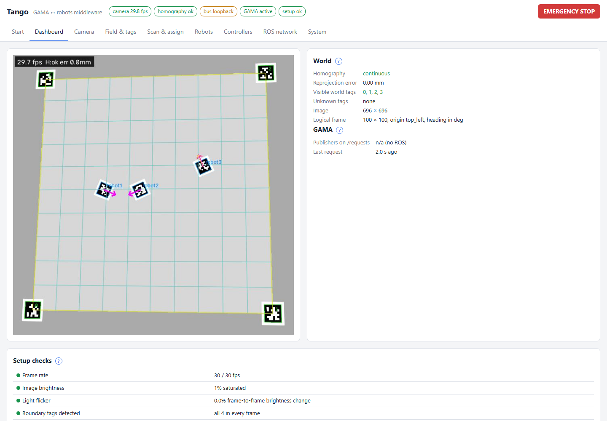

# 5. Running the demo
{: .no_toc }

1. TOC
{:toc}

## Checklist

On the middleware's **Start** tab, every step should be green except the last one (GAMA is not
running yet):

1. Camera streaming — the phone is connected.
2. Boundary tags in view — all 4, small reprojection error.
3. Image quality — no red setup check.
4. Robots seen by the camera — 3/3.
5. Robots listening on ROS — 3/3 with a subscriber.
6. Robots calibrated — 3/3.
7. Home positions set — optional (the demo model sends its own).

Keep the **EMERGENCY STOP** button (top right of every page) at hand: it stops every robot at once,
including during placement and calibration. Click it again to release.

## Run the GAMA model

Open [tango_demo.gaml](gama/tango_demo.gaml) in GAMA and run the **demo** experiment. What happens:

1. **Placement.** At start-up the model publishes on `/tango/requests`:

   ```json
   {"place": {"robot1": {"x": 25, "y": 80, "heading": 270},
              "robot2": {"x": 50, "y": 80, "heading": 270},
              "robot3": {"x": 75, "y": 80, "heading": 270}}}
   ```

   The middleware drives the robots there one after the other. GAMA follows their progress in
   `/tango/robots/state` (`goal.status`: `queued`, `moving`, `turning`, `arrived`) and shows each start
   position as a square. The *Phase* monitor shows `placing`.
2. **Run.** When the 3 robots have `arrived`, the phase becomes `running`: on every cycle (10 per second)
   GAMA reads where the robots really are, picks a waypoint for each, steers it away from the others, and
   publishes one request per robot:

   ```json
   {"requests": [{"robot": "robot1", "speed": 8.0, "heading": 135.0}, ...]}
   ```

   Speeds are in GAMA units per second (8 units/s ≈ 12 cm/s on a 1.5 m field), headings in GAMA degrees.
   The middleware's controller turns them into wheel commands, with each robot's calibration.

The dashboard shows the robots, what they were asked and the command sent to them:



The model's two parameters (cruise speed, distance kept between robots) can be changed while it runs.

## Stopping

- **Pause or stop GAMA**: the requests stop, and after `safety.request_timeout` (1 s) every robot stops
  by itself.
- **Emergency stop** in the middleware, or publish `true` on `/tango/estop`.
- A robot also stops by itself if its tag is lost for 0.5 s, if the camera mapping is lost, or if it
  leaves the field (it can then only be driven back in).

To run again: stop the experiment, reload it: the placement starts over.

## Going further

- Change the behaviour in the `decide` reflex of the `tango_robot` species: anything that computes a
  speed and a heading per robot works.
- Send a robot to a precise point at any time, from GAMA:
  `{"robot": "robot2", "goto": {"x": 50, "y": 50, "heading": 0}}`.
- Use other robots: change their names in `robot_names`, their tags and outputs in the middleware.
- See [Talking to the middleware](reference.md) for every message and topic.
