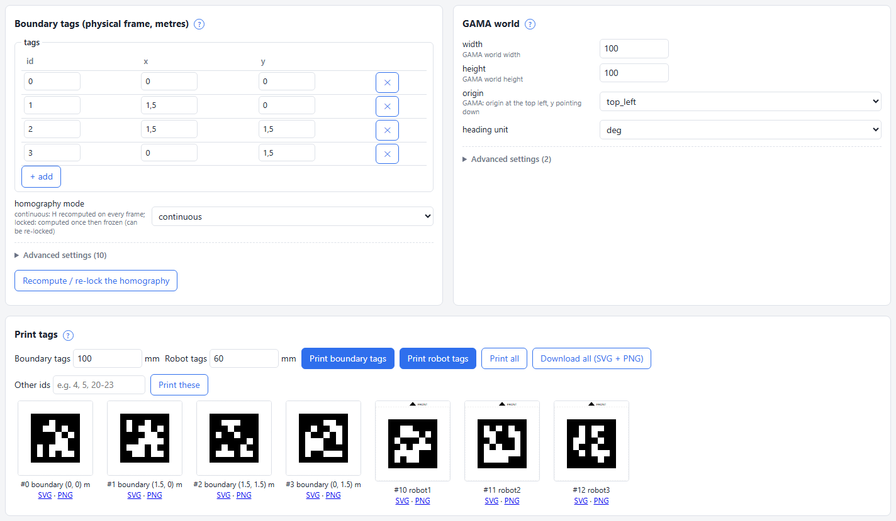
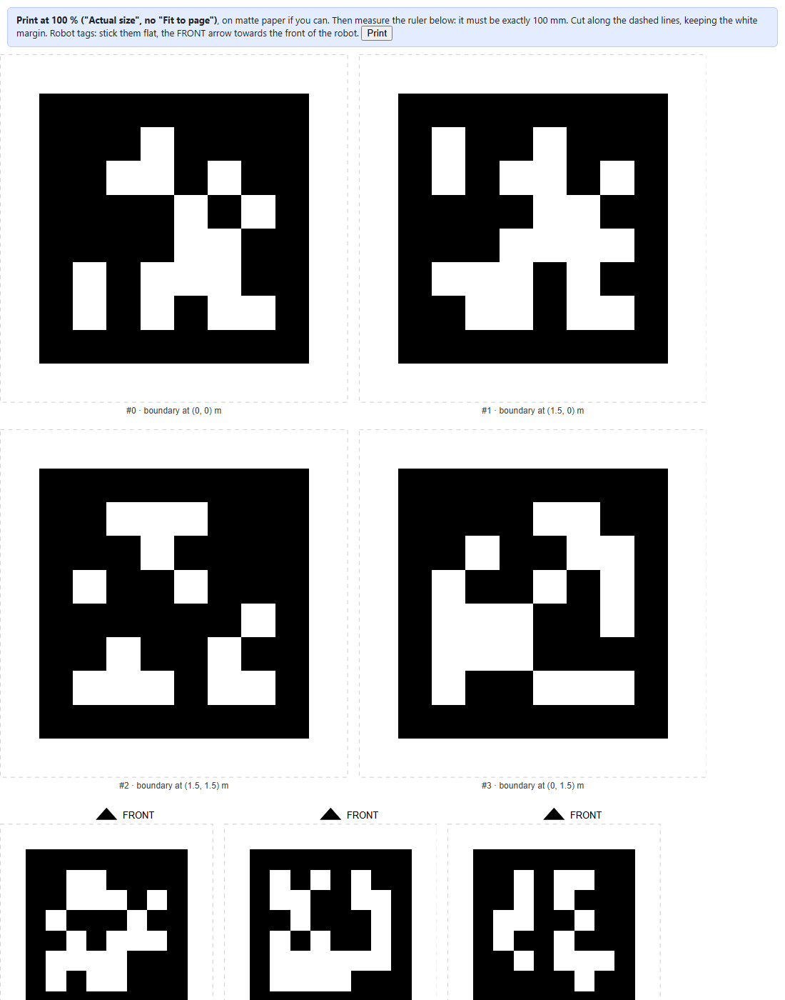

# 1. Hardware setup
{: .no_toc }

1. TOC
{:toc}

## The field

Pick a flat, matte floor of at least **1.7 m × 1.7 m** (the 1.5 m field plus room for the robots to
turn at the edges). Avoid shiny floors under a window or a spot light: reflections hide the tags.

The field is defined by the **centres** of 4 tags, in metres, with `x` to the right and `y` "up" (away
from you when you stand on the tag 0 side):

| Tag | Position (centre) | Corner |
|---|---|---|
| 0 | (0, 0) | bottom left |
| 1 | (1.5, 0) | bottom right |
| 2 | (1.5, 1.5) | top right |
| 3 | (0, 1.5) | top left |

GAMA uses its own coordinates: the middleware maps the square onto a **100 × 100 GAMA world** with the
origin at the **top left** (tag 3) and `y` pointing down, so GAMA (0, 0) is tag 3 and GAMA (100, 100)
is tag 1. You never convert anything by hand: the middleware speaks GAMA units to GAMA.

## Printing the tags

The middleware prints the tags of its configuration at their real size. Start it (see
[Software setup](software.md)), open **Field & tags**, then:

- **Boundary tags**: 100 mm, **Print boundary tags** (tags 0–3);
- **Robot tags**: 60 mm, **Print robot tags** (tags 10, 11, 12, with a **FRONT** arrow).

In the print dialog choose **100 %** / **Actual size** (never "Fit to page"), then check the 100 mm ruler
at the bottom of the sheet with a real ruler. Matte paper avoids glare. Cut along the dashed lines,
**keeping the white margin**: the detector needs the white frame around the black square.

Other buttons: **Download all (SVG + PNG)** gives vector files at real size (for a print shop or
cardboard/foam board), and **Other ids** prints any tag (e.g. spares, or extra landmarks).

> Tag size rule of thumb: the camera must see at least **3 pixels per bit** of a tag (a tag36h11 is
> 8 bits wide, black border included). The *Setup checks* tell you the actual value; 100 mm boundary
> tags and 60 mm robot tags are comfortable at 1280×960 from 1.8 m.

## Laying the boundary tags

1. Stick tag **0** where you want the bottom-left corner, flat, with tape on its white margin only.
2. With the tape measure, place tag **1** so that the distance **between the centres** of tags 0 and 1
   is exactly **1.50 m**. Same for tag **3** from tag 0, and tag **2** from tags 1 and 3.
3. Check the two diagonals: they must be equal (2.12 m). If not, the field is not square: move tag 2.
4. The orientation of the boundary tags does not matter. Only their centres are used.

An error of a few millimetres is fine: the dashboard shows the **reprojection error** (how well the 4
tags agree with their configured positions); below 10 mm is good.

## Tags on the robots

- Stick each tag **flat** on the top of its robot, as **centred** as possible over the point the robot
  turns around (the middle of the wheel axle for a differential robot).
- The **FRONT** arrow points to the **front** of the robot. A small angle error is measured later by the
  calibration (`heading_offset`).
- Nothing may stand above the tag (cables, sensors): from above, the whole tag and its white margin
  must be visible.
- In this scenario: **robot1 → tag 10**, **robot2 → tag 11**, **robot3 → tag 12**. If you mix them up,
  the middleware can find out which is which (see *Identify* in [Configuration](configuration.md)).

> **Tall robots**: a tag 20 cm above the floor seen from 1.8 m appears shifted outwards by up to 10 % of
> its distance to the point below the camera. If your robots are taller than a few centimetres, enable
> *parallax correction* in the configuration (`world.parallax`: camera position and height) and set each
> robot's `calibration.tag_height`.

## The phone above the field

- Mount the phone **pointing straight down**, above the **centre** of the field, in **landscape**.
  Any stable holder works: a microphone stand with a boom, a camera tripod with a horizontal arm, a
  clamp on a shelf or a beam. It must not move or vibrate.
- **Height**: for a 1.5 m square seen in **4:3** (1280×960) by a typical phone main camera (≈ 70° × 55°),
  about **1.8 m** above the floor shows the 4 tags with a margin. In 16:9 you would need ≈ 2.3 m.
  Rule: `height ≈ (half the covered size) / tan(half the field of view)`; in practice, adjust until the
  live view shows the 4 corner tags with some room around them.
- **Plug the phone in**. Lock its screen once streaming: it keeps working and uses much less power.
- The phone sends images in its sensor orientation (landscape). If the field appears rotated or
  mirrored, use `camera.rotate` / `camera.flip` in the middleware (or the *Rotation*/*Mirror* options
  when scanning).

## Light

- **Even**, diffuse light: ceiling lights, or daylight without direct sun on the field. Avoid spots that
  make bright patches and reflections on the tags.
- Moving robots need **short exposures** to stay sharp, hence **light**: the middleware's
  *Setup checks* show the phone's exposure time and ISO, and the *motion blur at full speed*.
- Mains-powered lights flicker at 100 Hz (Europe). With a short exposure cap, use **10 ms** or **20 ms**
  so the brightness does not pulse between frames (the *Light flicker* check detects it).

## Network

- PC, phone and robots on the **same local network**. A dedicated Wi-Fi router is the safest choice:
  guest or enterprise Wi-Fi networks often isolate devices from each other, which blocks both the phone
  and ROS 2.
- On **Windows**, set the Wi-Fi network as **private**, and allow Python through the firewall when asked
  (ports 47800 TCP+UDP and 47801 TCP for the phone, plus ROS 2 traffic).

Next: [Software setup](software.md).
