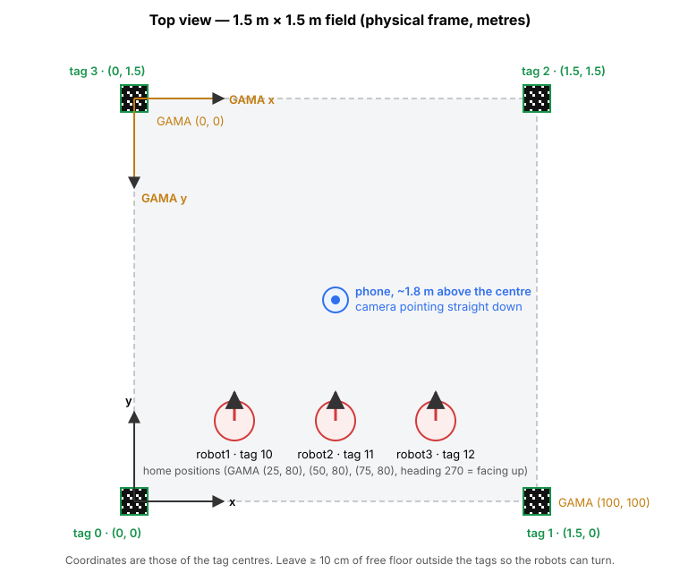
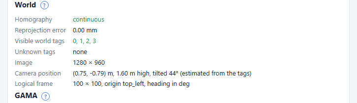
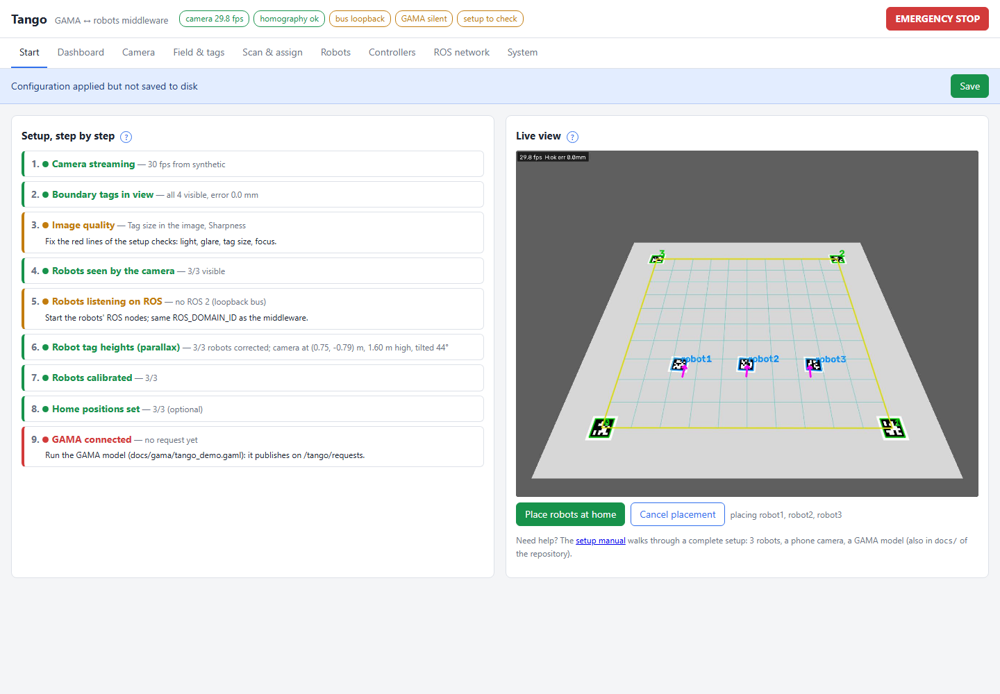
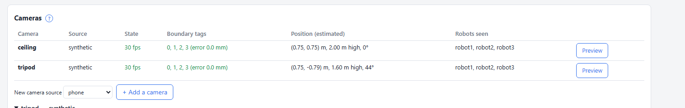
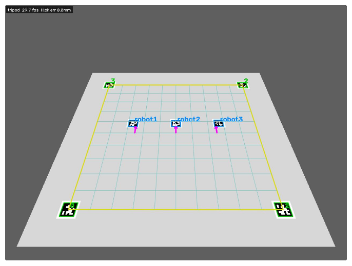
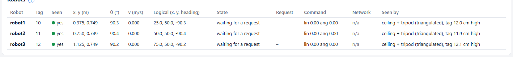

# 1. Hardware setup
{: .no_toc }

1. TOC
{:toc}

## The field

Pick a flat, matte floor of at least **1.7 m × 1.7 m** (the 1.5 m field plus room for the robots to
turn at the edges). Avoid shiny floors under a window or a spot light: reflections hide the tags.

The field is defined by the **centres** of 4 tags, in metres, with `x` to the right and `y` "up" (away
from you when you stand on the tag 0 side):

| Tag | Position (centre) | Corner |
|---|---|---|
| 0 | (0, 0) | bottom left |
| 1 | (1.5, 0) | bottom right |
| 2 | (1.5, 1.5) | top right |
| 3 | (0, 1.5) | top left |

GAMA uses its own coordinates: the middleware maps the square onto a **100 × 100 GAMA world** with the
origin at the **top left** (tag 3) and `y` pointing down, so GAMA (0, 0) is tag 3 and GAMA (100, 100)
is tag 1. You never convert anything by hand: the middleware speaks GAMA units to GAMA.

## Printing the tags

The middleware prints the tags of its configuration at their real size. Start it (see
[Software setup](software.md)), open **Field & tags**, then:

- **Boundary tags**: 100 mm, **Print boundary tags** (tags 0–3);
- **Robot tags**: 60 mm, **Print robot tags** (tags 10, 11, 12, with a **FRONT** arrow).

In the print dialog choose **100 %** / **Actual size** (never "Fit to page"), then check the 100 mm ruler
at the bottom of the sheet with a real ruler. Matte paper avoids glare. Cut along the dashed lines,
**keeping the white margin**: the detector needs the white frame around the black square.

Other buttons: **Download all (SVG + PNG)** gives vector files at real size (for a print shop or
cardboard/foam board), and **Other ids** prints any tag (e.g. spares, or extra landmarks).

> Tag size rule of thumb: the camera must see at least **3 pixels per bit** of a tag (a tag36h11 is
> 8 bits wide, black border included). The *Setup checks* tell you the actual value; 100 mm boundary
> tags and 60 mm robot tags are comfortable at 1280×960 from 1.8 m.

## Laying the boundary tags

**No tape measure needed.** Lay the 4 tags roughly at the corners of the area you want (tag 0 bottom
left, 1 bottom right, 2 top right, 3 top left, seen from the side of tag 0), flat, with tape on their
white margin only. Their orientation does not matter.

The corner tags **define** the field: the GAMA world is the quadrilateral they form, wherever they are,
and every position is computed relative to them. A field that is not quite square, or a tag a few
centimetres off, only means the GAMA world is that slightly different shape: nothing to correct.

The real size only sets the units (speeds in m/s, placement tolerances). The middleware estimates it from
the **printed size of the tags** (*Scan & assign*, see [Configuration](configuration.md)): within about
2 %, which is plenty. Type a measured size instead if you have one.

The tags must just stay where they are once set up (tape them down): moving a corner tag moves the GAMA
world with it.

## Tags on the robots

- Stick each tag **flat** on the top of its robot, as **centred** as possible over the point the robot
  turns around (the middle of the wheel axle for a differential robot).
- The **FRONT** arrow points to the **front** of the robot. A small angle error is measured later by the
  calibration (`heading_offset`).
- Nothing may stand above the tag (cables, sensors): from above, the whole tag and its white margin
  must be visible.
- In this scenario: **robot1 → tag 10**, **robot2 → tag 11**, **robot3 → tag 12**. If you mix them up,
  the middleware can find out which is which (see *Identify* in [Configuration](configuration.md)).

- **Measure the height of each tag above the floor** (ruler, in cm): you will type it in each robot's card
  (*Tag height*). Seen at an angle, a raised tag appears away from its robot; the middleware corrects it
  with this height and the camera position, which it works out by itself from the boundary tags.

## The phone above the field

Two placements work: **above the field** (the most accurate and the easiest, described here) or
**at head height on a tripod** in front of the field (see [the next section](#camera-at-head-height)).

- Mount the phone **pointing straight down**, above the **centre** of the field, in **landscape**.
  Any stable holder works: a microphone stand with a boom, a camera tripod with a horizontal arm, a
  clamp on a shelf or a beam. It must not move or vibrate.
- **Height**: for a 1.5 m square seen in **4:3** (1280×960) by a typical phone main camera (≈ 70° × 55°),
  about **1.8 m** above the floor shows the 4 tags with a margin. In 16:9 you would need ≈ 2.3 m.
  Rule: `height ≈ (half the covered size) / tan(half the field of view)`; in practice, adjust until the
  live view shows the 4 corner tags with some room around them.
- **Plug the phone in**. Lock its screen once streaming: it keeps working and uses much less power.
- The phone sends images in its sensor orientation (landscape). If the field appears rotated or
  mirrored, use `camera.rotate` / `camera.flip` in the middleware (or the *Rotation*/*Mirror* options
  when scanning).

## Camera at head height

A tripod or a stand at head height in front of the field (1.5–1.7 m, the phone tilted down towards the
field) also works: the floor tags define the mapping whatever the viewing angle, and the middleware
estimates where the camera is from them. Measured with a simulated phone camera (1280×960, 70°) on the
1.5 m field:

| Camera | Robot tags on the floor | Tags 10 cm high, height **not** set | Tags 10 cm high, height set |
|---|---|---|---|
| Above the field, 1.8 m | 1 mm | 38 mm | 1 mm |
| Head height 1.6 m, 0.8 m in front | 3 mm | 139 mm | 2 mm |
| Tripod at a corner, 1.7 m | 2 mm | 132 mm | 2 mm |

(Simulated with a perfect lens: expect a few mm more for real.) So with a camera at head height:

- **Type every robot's tag height** (Robots tab → *Tag height*). This is the one thing that matters: without
  it positions are off by 10–30 cm. The *Tag height correction* setup check and the Start tab tell you when
  it is missing, and by how much positions would be off.
- **Frame the 4 corner tags with a margin**: the near ones tend to fall out at the bottom of the image.
- **Use `homography mode: locked`** (Field & tags): computed once with the field empty, it stays valid when
  robots pass in front of a corner tag, which happens a lot at a low angle. If the tripod gets bumped, it is
  recomputed automatically.
- **Bigger robot tags or a higher resolution**: the far side of the field is seen from further away and
  at an angle. 60 mm tags give only 1.5–3 pixels per bit at 1280×960: prefer 80–100 mm robot tags, or
  1920×1440. The *Tag size in the image* check gives the real value.
- Tall robots can hide each other from a low camera: put the camera higher, or on the side where robots
  rarely line up.

The dashboard shows where the middleware thinks the camera is (*Camera position*), which is a quick sanity
check of the setup:

> Try a placement before installing it: in the configuration set `camera.source: synthetic`,
> `camera.synthetic.view: oblique`, and `camera.synthetic.camera_x/camera_y/camera_height` (empty x/y =
> centred, 0.8 m in front of the field) and `robot_tag_height`. The simulator then renders what a real
> camera there would see, with the parallax of the robot tags.

## Several cameras

Two phones (or more, or a phone and a USB camera) can film the field together:

- **No blind spots**: a robot hidden from one camera (by another robot, or out of its view) is still seen
  by another. Particularly useful with cameras at head height.
- **Bigger fields**: each camera covers part of it.
- **No tag height to measure**: a robot seen by two cameras is **triangulated**, so its ground position no
  longer depends on its tag height, which is measured on the way (and then used when only one camera
  sees the robot).

Each camera must see **at least 4 boundary tags** (all four corners, or corners plus extra landmarks):
it finds its own position from them, and all cameras then share the same frame — nothing to calibrate
between them. A good pair: one camera above the field and one at head height on a side, or two tripods
on two adjacent sides.

**Camera** tab → *Cameras* → choose the source (*phone*, USB, simulated) → **+ Add a camera**, then
**Apply & save**. For phones: open Tango Camera on the second phone, it pairs with the same code; each
phone is given a camera and gets it back after a reboot (*Phones per camera* in the phone card; *Forget
phone* frees a camera, e.g. to swap two phones).

The *Preview* buttons (or the camera selector above every live view) show what each camera sees, with
the fused robot positions drawn on it:

The dashboard tells which cameras see each robot, and the measured tag heights (simulation: tags really
12 cm high, nothing entered):

Measured in simulation (2 cameras, 1.5 m field, tags 12 cm high, height not entered): robots located
within 1 mm by triangulation, tag heights measured within 2 mm. Positions and heights typed by hand
still take priority where you enter them.

> Notes: the cameras are not synchronised (each image is stamped on arrival); the fusion brings the
> observations to the same instant with the robots' speed. Each phone uses 4–8 Mbit/s at 720p: 3–4
> phones are fine on 5 GHz Wi-Fi. Every camera costs ~10–20 ms of processing per frame on the PC.

## Light

- **Even**, diffuse light: ceiling lights, or daylight without direct sun on the field. Avoid spots that
  make bright patches and reflections on the tags.
- Moving robots need **short exposures** to stay sharp, hence **light**: the middleware's
  *Setup checks* show the phone's exposure time and ISO, and the *motion blur at full speed*.
- Mains-powered lights flicker at 100 Hz (Europe). With a short exposure cap, use **10 ms** or **20 ms**
  so the brightness does not pulse between frames (the *Light flicker* check detects it).

## Network

- PC, phone and robots on the **same local network**. A dedicated Wi-Fi router is the safest choice:
  guest or enterprise Wi-Fi networks often isolate devices from each other, which blocks both the phone
  and ROS 2.
- On **Windows**, set the Wi-Fi network as **private**, and allow Python through the firewall when asked
  (ports 47800 TCP+UDP and 47801 TCP for the phone, plus ROS 2 traffic).

Next: [Software setup](software.md).
