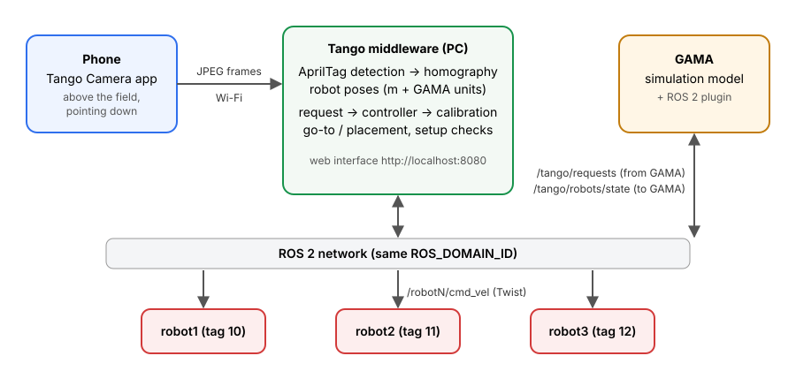
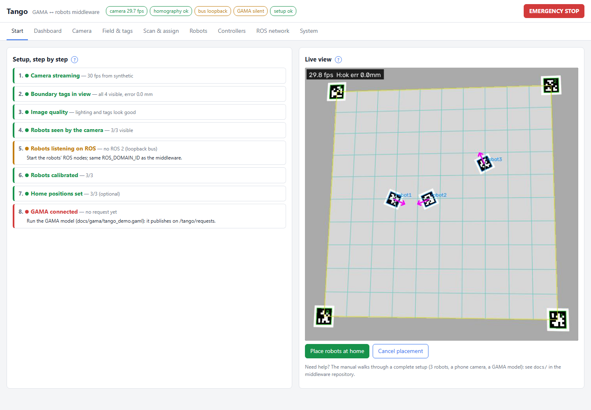

# Tango setup manual

Tango lets a **GAMA** simulation drive **real robots**. A camera above the floor follows the robots
thanks to the AprilTags stuck on them; the **Tango middleware** turns what the camera sees into GAMA
coordinates, and turns GAMA's orders (go at this speed, in this direction, or go to this point) into
commands for each robot over **ROS 2**.

This manual walks through a complete, concrete setup from scratch:

- a **square field of 1.5 m × 1.5 m**, delimited by **4 tags laid on the floor**;
- **3 differential robots** (two driven wheels, e.g. TurtleBot3, AlphaBot2…), each with a **tag on top**;
- an **Android phone** as the camera, running the **Tango Camera** app, above the field;
- a **GAMA model** that first brings the robots to their start positions, then makes them wander
  around the field while keeping away from each other.

## What you need

| | |
|---|---|
| A PC (Linux, Windows or macOS) | runs the middleware and, usually, GAMA |
| ROS 2 (Humble, Jazzy…) | on the PC and on the robots, same `ROS_DOMAIN_ID` |
| 3 differential robots | each listening to `geometry_msgs/Twist` on `/robotN/cmd_vel` |
| An Android phone (Android 7+) | the camera. An iPhone also works through a web page |
| A phone holder | a mic stand, a tripod with an arm, or a clamp on a shelf, ~1.8 m above the floor |
| A printer, A4 paper (matte if possible), scissors, tape | for the tags |
| A tape measure | to place the corner tags |
| A Wi-Fi network | the phone, the PC and the robots on the same network |

## The steps

1. [Hardware setup](hardware.md): the field, printing and laying the tags, the robots, the phone holder, the light.
2. [Software setup](software.md): the middleware, ROS 2, the phone app, GAMA and its ROS plugin.
3. [Configuration](configuration.md): the field, the camera, the robots, the setup checks.
4. [Calibration](calibration.md): measure each robot, choose its start position.
5. [Running the demo](demo.md): the GAMA model, placement, the run, stopping safely.
6. [Talking to the middleware](reference.md): requests, go-to, placement, topics — to write your own models.
7. [Troubleshooting](troubleshooting.md).

The middleware's web interface follows the same order: its **Start** tab lists the steps and turns
each one green when it is done.

> Everything can be tried without hardware first: run `python -m tango_mw run --camera synthetic`.
> The built-in simulator shows a virtual field with simulated robots that react to the commands.
> The screenshots of this manual were taken with it.
