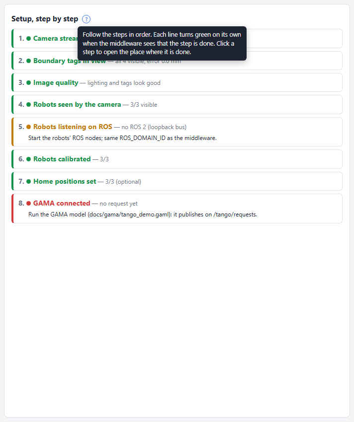
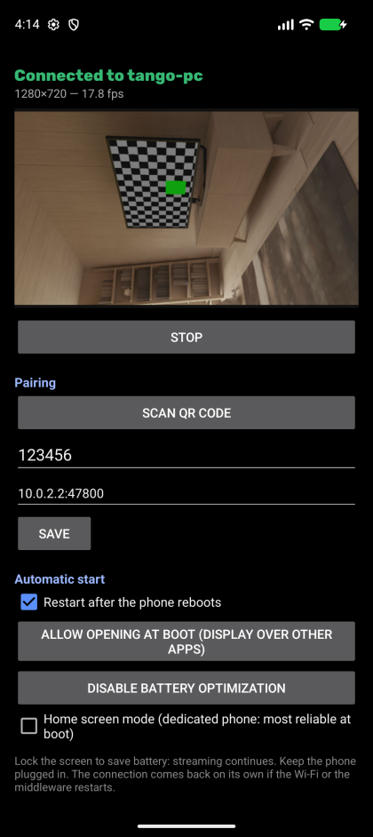
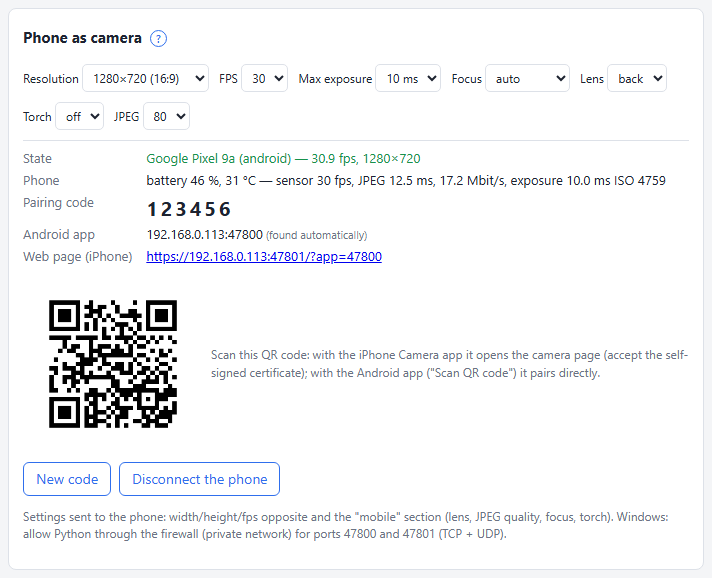

# 2. Software setup
{: .no_toc }

1. TOC
{:toc}

## ROS 2 on every machine

The PC (middleware + GAMA) and the 3 robots talk over ROS 2. Use the same distribution where possible
(Humble or Jazzy) and, on **every** machine, the same domain:

```bash
export ROS_DOMAIN_ID=42          # Linux / macOS (add it to ~/.bashrc)
setx ROS_DOMAIN_ID 42            # Windows (new terminals)
```

Check from the PC that the robots are visible once they run: `ros2 topic list` must show
`/robot1/cmd_vel`, `/robot2/cmd_vel`, `/robot3/cmd_vel`.

## The robots

Each robot runs its usual ROS 2 driver, **namespaced** with its name, so that it listens to
`geometry_msgs/Twist` on `/robotN/cmd_vel`. For example:

- **TurtleBot3**: `ros2 launch turtlebot3_bringup robot.launch.py namespace:=robot1` (one per robot);
- **AlphaBot2** or another small robot without a ROS driver: the ROS plugin for GAMA ships a small
  bridge (`models/Recipes/ROS2/includes/alphabot2/alphabot2_bridge.py` in
  [gama.plugin.ros](https://github.com/projet-tango/gama.plugin.ros)) that you can adapt;
- any robot whose topic or message differs: change the robot's **output** in the middleware (topic
  template, `twist`, `wheels` = `Float64MultiArray [left, right]`, or `json`).

The robots do **not** need odometry, localisation or a map: the camera gives their position.

## The middleware

```bash
git clone https://github.com/projet-tango/tango-middleware.git
cd tango-middleware
python -m venv .venv && source .venv/bin/activate     # Windows: .venv\Scripts\activate
pip install -e .
source /opt/ros/jazzy/setup.bash                      # Windows: call C:\dev\ros2\local_setup.bat
mkdir -p config && cp docs/examples/config-3-robots.yaml config/config.yaml
python -m tango_mw run
```

Open **http://localhost:8080**. The [example configuration](examples/config-3-robots.yaml) already
describes this manual's scenario (field, robots, phone camera, GAMA world, ROS domain 42).



Every section of the interface has a **?** bubble: hover it (or tap it on a tablet) for an explanation.
Settings that are rarely needed are folded under **Advanced settings**.

### Start it automatically

Once everything works, make the middleware start with the PC and restart if it stops:

```bash
python -m tango_mw service install --ros-setup /opt/ros/jazzy/setup.bash
```

(systemd on Linux, a scheduled task at logon on Windows, launchd on macOS; `service status`,
`service uninstall`.) The phone reconnects on its own when the middleware restarts.

## The phone: Tango Camera

1. On the phone, download **tango-camera.apk** from the
   [Tango Camera releases](https://github.com/projet-tango/tango-camera-mobile/releases) (or the
   *Android APK* artifact of its GitHub Actions), open it and allow the installation.
2. In the middleware, **Camera** tab: the source is `mobile` (already set by the example configuration;
   otherwise click **Use a phone as camera**). The **Phone as camera** card shows a **pairing code** and a
   **QR code**.
3. Open **Tango Camera** on the phone, allow the camera and notifications. It finds the middleware by
   itself on the network: type the code, or tap **Scan QR code** and scan the card. Done: the code is
   remembered and the phone reconnects on its own from now on (Wi-Fi drop, middleware or phone restart).

 

The card's **quick settings** are applied to the phone at once: resolution (prefer **1280×960, 4:3** for
a square field), frame rate, **max exposure** (10 ms limits the motion blur), focus (**fixed** avoids the
autofocus hunting), torch.

**Auto-start after a phone reboot**: in the app, tap **Allow opening at boot** and **Disable battery
optimization**. For a phone dedicated to this job, tick **Home screen mode**: Android then opens the app at
every boot.

> **iPhone**: no app to install. Scan the card's QR code with the iPhone Camera app, accept the
> self-signed certificate, tap **Start camera**. Keep the page in front (the browser stops the camera
> when the screen locks).

## GAMA and its ROS 2 plugin

1. Install [GAMA](https://gama-platform.org) (2026 release or later).
2. Install the ROS 2 plugin: follow the README of
   [projet-tango/gama.plugin.ros](https://github.com/projet-tango/gama.plugin.ros). Its example models
   then appear in the model library (*Recipes / ROS2*); run *01 Hello ROS* to check the plugin.
3. Start GAMA from an environment where `ROS_DOMAIN_ID=42` is set.
4. Import the demo model: [docs/gama/tango_demo.gaml](gama/tango_demo.gaml) (copy it into a GAMA
   project).

Next: [Configuration](configuration.md).
